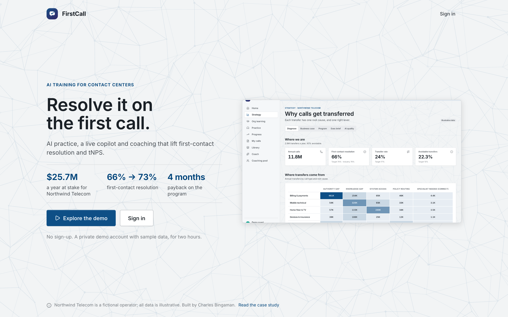
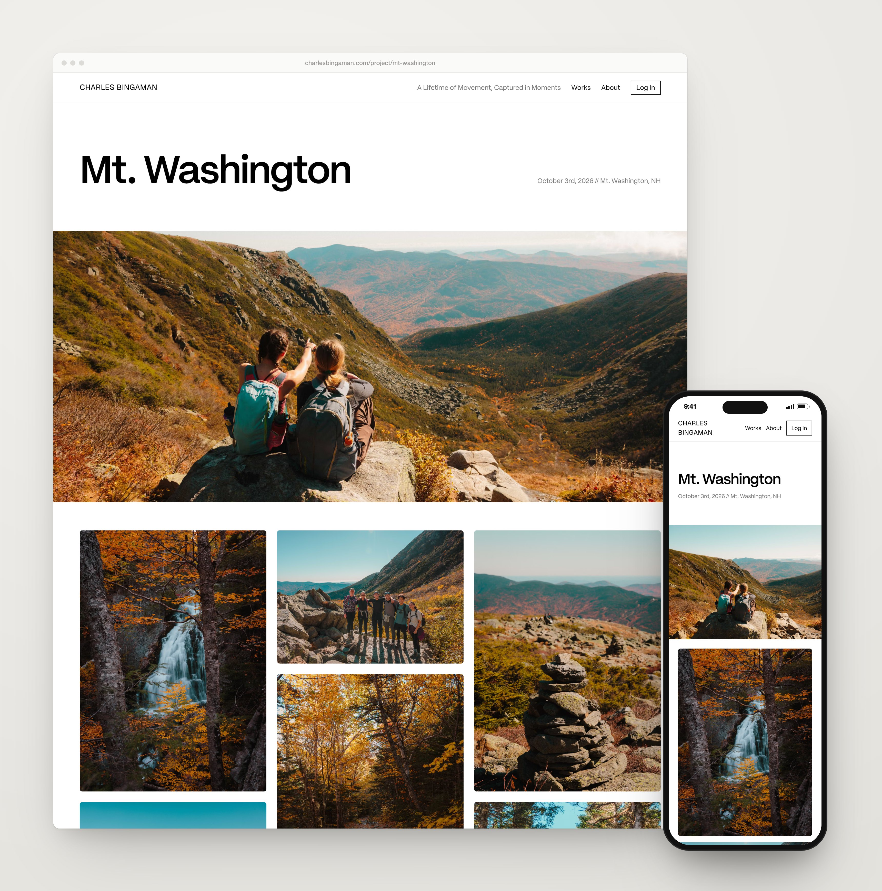
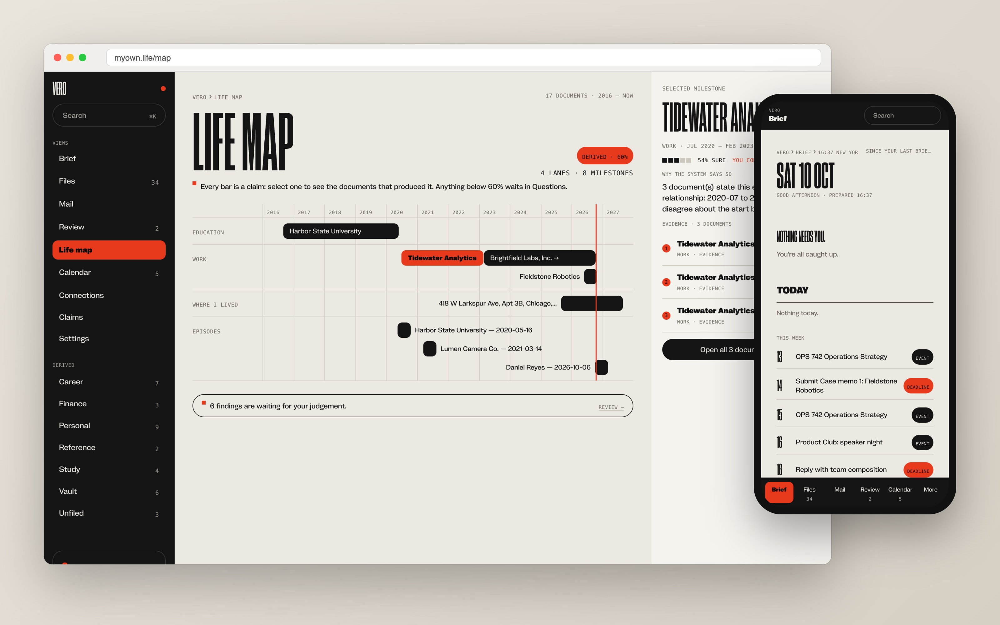

# Charles Bingaman: selected work

I build AI products end to end, from the business problem to a secure, live product. Each case study covers the
problem, the decisions and trade-offs, the hard parts, and real numbers. Code is private but available on request.

## [FirstCall](case-studies/firstcall.md): why calls get transferred, what fixing it is worth, and the AI that fixes it

For a (fictional) operator: transfers diagnosed by root cause and sized lever by lever (training fixes only 43% of them),
a sourced business case with sensitivity, a matched-control pilot design, and the AI practice platform that delivers it:
voice calls with an AI customer, copilot, debriefs, PII redaction and measured AI quality. **One-click demo, built in one day.**
[Case study](case-studies/firstcall.md) · [Live demo](https://firstcall-psi.vercel.app)

## [PayUp](case-studies/payup.md): shared expenses that get split right, in any currency

One typed sentence or a receipt photo becomes a correctly split expense across 162 currencies, and an AI assistant can
operate it safely through 17 MCP tools. **377 commits in 25 active days.**
[Case study](case-studies/payup.md) · [Live](https://www.yopayup.com)

## [charlesbingaman.com](case-studies/photo-site.md): portfolio, client platform and photo map in one

Replaces two paid photography products on near-free infrastructure, with free subject-aware cropping (69% vs 18% for
centre-cropping) and location privacy by design.
[Case study](case-studies/photo-site.md) · [Live](https://www.charlesbingaman.com)

## [Vero](case-studies/vero.md): a personal archive AI can use, with a hard line around what it must never see

An encrypted archive that files itself: every document becomes sourced, dated metadata, a life map and an entity
graph, and AI agents use it over MCP without ever seeing what's in the vault. **1,398 commits in 28 active days.**
[Case study](case-studies/vero.md) · [Live](https://myown.life) (private)

## [Hackathon template](case-studies/hackathon-template.md): from two questions to a live, secure app a whole team can build on

One command turns an idea and a team list into a live app with a security and design baseline, so 6–8 beginners can
build on the same live site without breaking it. **FirstCall was its first full run.**
[Case study](case-studies/hackathon-template.md)

## [What's the Move Boston](case-studies/whatsthemove.md): eight people, mostly beginners, one live app in 90 minutes

"What should we do tonight?" for solo nights and group plans with voting. I set up the system that let a team of 8
build on one live site at once. **Built in 90 minutes.**
[Case study](case-studies/whatsthemove.md) · [Live](https://whatsthemoveboston.com)

---
© 2026 Charles Bingaman. All rights reserved.
