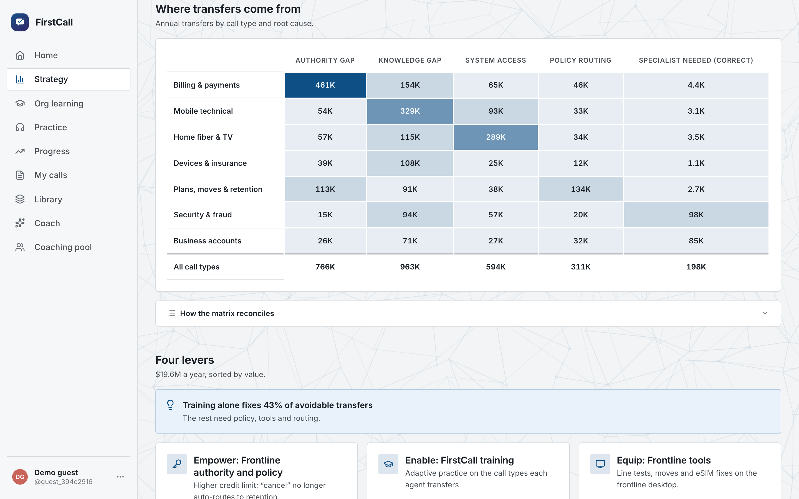
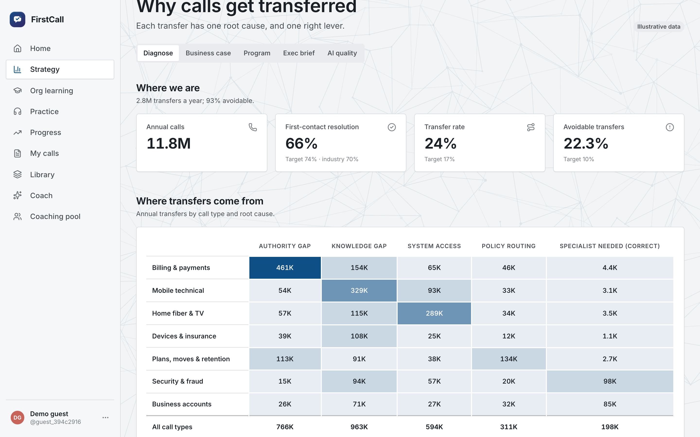
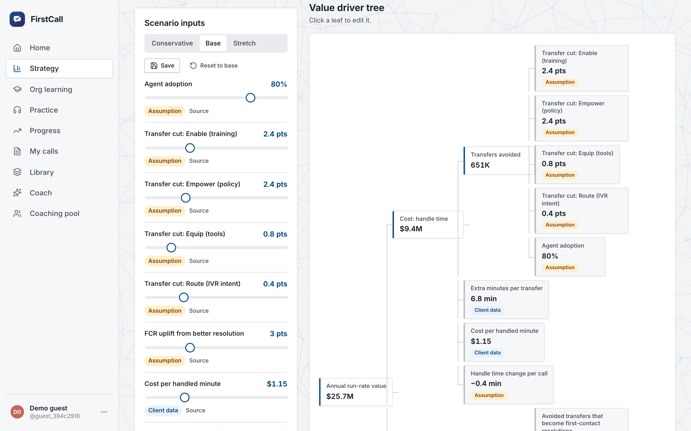
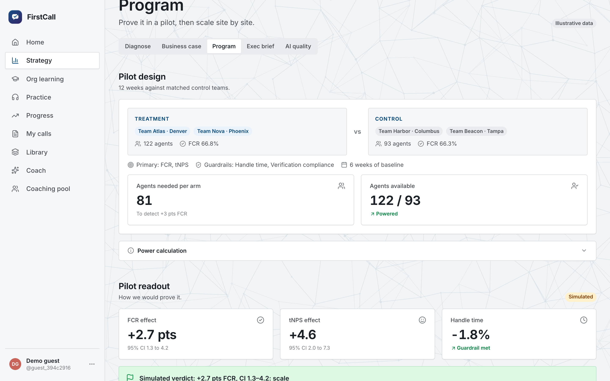
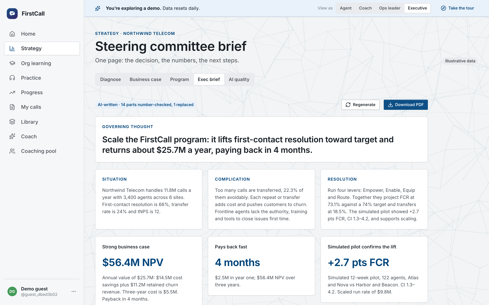
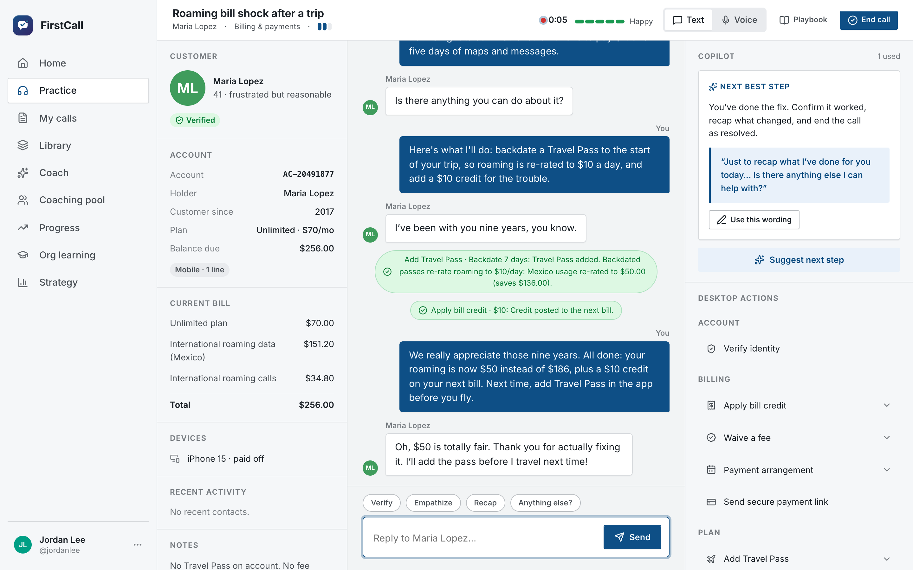
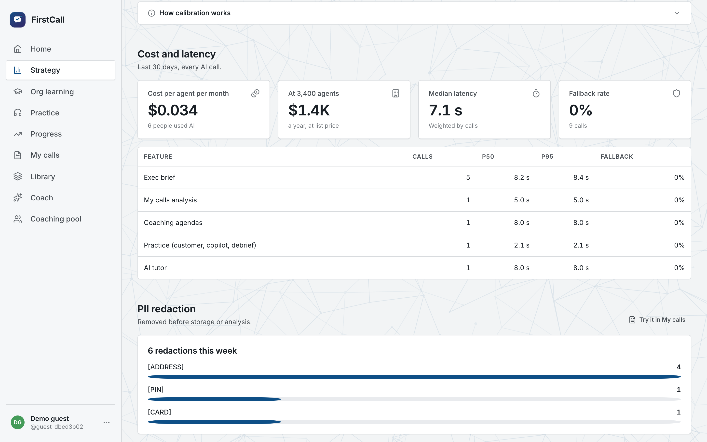
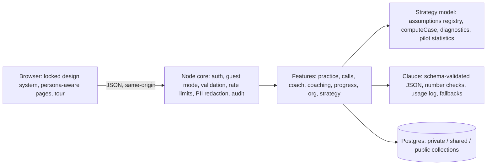

# FirstCall: from "train the agents" to a business case for resolving calls the first time

**Live:** [firstcall-psi.vercel.app](https://firstcall-psi.vercel.app) · one-click demo, no sign-up, with a 60-second guided tour · Code available on request.

## The problem
The client is a fictional operator selling mobile, home fiber, TV, devices and insurance. Its contact center takes 11.8M calls a year, transfers 24% of them and resolves 66% on first contact. The brief said "train the agents". The diagnosis says that's only part of the answer.

## What I did
**1. Diagnosed why calls get transferred.** I coded every transfer by root cause (knowledge, authority, system access, policy routing, or a genuine specialist need) and mapped call type × root cause into one matrix that reconciles to the 24% headline. The finding that changes the plan: **training alone fixes only 43% of avoidable transfers**. The rest are authority limits, routing rules, tools agents can't reach, and calls that should go to a specialist from the start.

**2. Matched each root cause to the right lever, and sized it in dollars.** I used four levers: *Enable* (training), *Empower* (authority and policy), *Equip* (frontline tools) and *Route* (intent routing). Each lever card shows the transfers it removes, FCR and tNPS points, value per year, cost, time to impact and an owner. A policy what-if shows the trade-off, not just the upside. Raising credit authority from $75 to $100 removes 143K transfers for +$3.0M net. Above $150, credit leakage outweighs the savings.

**3. Built a business case that answers "based on what?".** It's a value driver tree on an assumptions registry. Every number is typed as client data, benchmark or assumption, with its source. Only figures I checked are called benchmarks (SQM Group's FCR research). Everything is editable, with Conservative, Base and Stretch presets and saved scenarios. The case produces NPV and payback, a waterfall from today's cost of transfers, a tornado, and a computed break-even: *the case holds unless delivered impact falls below 8% of plan.*

**4. Designed how to prove it.** Matched control teams are picked by baseline FCR. A power calculation accounts for clustering of calls within agents: 81 agents per arm to detect +3 pts FCR. A difference-in-differences readout produces a confidence interval and a go/no-go gate. The readout in the demo is **simulated** from the teams' baselines and labeled as such everywhere. The program also has a 90-day roadmap with gates, change management (supervisors become a bookable coach pool, FCR incentives, works council consultation, an AI trust policy) and a risk register with owners.

**5. Gave each stakeholder their own product.** A "View as" switcher (agent, coach, ops leader, executive) changes the first screen and the navigation. It's a view preference, never a permission. The executive sees KPIs against target and the value at stake. Their one-pager is written by AI from the live model. The server checks every number it contains against the data, falls back to a template when AI is off, and prints to a single PDF page.

**6. Built the AI system that delivers it.** Agents practice against an AI customer, by text or by voice. The agent's speech is transcribed in the browser, and the customer talks back with a voice that tracks her mood and stops when the agent interrupts. The workspace is a real agent desktop with authority limits, alongside a live copilot, AI debriefs, adaptive learning plans and org-wide learning from recorded calls.

## Making the AI trustworthy
- **Measured, not assumed.** Coaches score sample calls blind, without seeing the AI's scores. Agreement is reported as weighted Cohen's kappa per skill. No human scores are invented: the panel stays empty until real reviews exist.
- **Safe by construction.** Card numbers (Luhn-checked), SSNs, phone numbers, emails, PINs, dates of birth and addresses are redacted before anything is stored or sent to the model. That covers uploaded calls, practice lines, voice transcripts and call notes. Model output is schema-validated JSON with length limits, and every AI feature has a deterministic fallback.
- **Costed and capped.** Every model call reserves its worst-case cost against a $1/day ceiling before it runs, then logs feature, model, tokens, cost, latency and whether a fallback was used, never content. High-volume roleplay turns use a fast, cheap model. The panel shows cost per agent per month, p50/p95 latency per feature and the fallback rate.

## Hard problems
**Keeping one source of truth.** The diagnostics, business case, exec home, one-pager and landing page all call one pure function over one registry. When an assumption changes, every screen agrees. A smoke test checks that the matrix reconciles to the headline and that the page and the model match.

**Honesty as a feature.** Fictional data is badged "Illustrative", simulated results are badged "Simulated", and benchmarks link to their source. In a consulting review, the credibility of the numbers matters more than the numbers themselves.

**A demo a reviewer can open in ten seconds.** One click creates a private guest account with seeded data (calls, a finished and an in-progress practice call, a coaching booking). Guests get a 2-hour session and lower per-person AI limits. The whole site can spend at most $1 of AI a day, and guests only get a slice of that $1; once it's used, features fall back calmly. Guest accounts are cleaned up lazily after 24 hours, without servers or timers.

## Architecture

## Stack
Plain JavaScript (Node 22) with no framework, no build step and no chart libraries · Postgres (Neon live, embedded PGlite locally) · Claude API · Web Speech API · Vercel serverless · GitHub Actions CI (ownership, design and security checks, 37 smoke tests, auto-revert).

## Timeline
- **Oct 10, morning:** FirstCall built on a hardened hackathon template: practice engine, AI customer, copilot, debriefs, learning loop, org learning.
- **Oct 10, afternoon:** the business-solution layer. Root-cause diagnostics and the policy what-if, the sourced business case, pilot design, the executive layer, AI quality, voice practice, and the public one-click demo with a guided tour. Each piece shipped behind CI and was verified on the live site.

---
The operator is fictional and all data is illustrative. The pilot readout is simulated. Code available on request.
