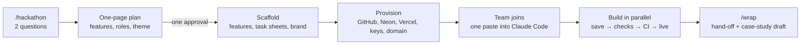
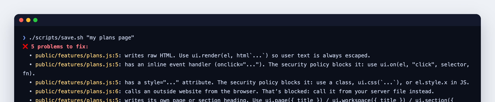

# Hackathon template: from two questions to a live, secure app a whole team can build on

**Private** · Role: designer and builder (solo, AI-assisted) · Sept–Oct 2026 · Plain JavaScript · Postgres (Neon, PGlite) ·
Vercel · GitHub Actions · Claude Code · 1Password CLI

*The two questions, and FirstCall, the first app built on the template. The terminal summarizes the real run.*

## TL;DR
- **One command turns an idea and a team list into a live app:** repo, database, hosting, keys, roles and task sheets,
  with a security and design baseline in place from the first commit.
- **Built so 6–8 beginners can push to the same live site without breaking it:** file ownership enforced three ways,
  30 automated security tests, and failing pushes reverted automatically.
- **First full run: [FirstCall](firstcall.md),** a 9-feature AI training platform built in one day and live from the
  first hour.

## The problem
I join hackathons with a new team every time, often people who have never shipped code. The first hours usually go to
setup (accounts, repos, a database, deploys), then the last hour goes to a broken demo because someone overwrote someone
else's work. The ideas were good; the plumbing and the coordination were what failed. I wanted every event to start from
a product that's already live, safe and good-looking, so the team spends its time on the idea.

## Approach and key decisions
- **Learned from a real event first.** At [What's the Move Boston](https://whatsthemoveboston.com) (8 people, 90 minutes)
  I used a rough version: one owner per file and a one-command save. The template turns those lessons into a system.
- **Claude Code as every teammate's pair.** Each project ships instructions telling Claude how to work with a beginner:
  plain English, small steps, only edit files you own, run the site for them. Nobody needs to know git.
- **Everyone on `main`, no pull requests.** Review is too slow for a 90-minute event, so the safety net is automated:
  checks before every save, re-checks in CI, automatic revert of anything red.
- **No framework, no build step.** Plain JavaScript modules mean nothing to install or configure; an embedded Postgres
  runs locally, and the same code runs on Neon in production.
- **Deploys only through CI.** The host isn't connected to the repo directly, so nothing reaches the live site without
  passing the checks.
- **Nobody handles secrets.** Keys live in 1Password and are passed straight from the vault to the providers by the
  provisioning scripts; teammates never see or paste one.

## How it works

- **Plan:** from the two answers Claude drafts the name, a 60-second demo story, 4–7 features, a role per person
  (matched to what they said they're good at) and a brand theme. It's the only approval step.
- **Scaffold:** every feature works end to end on the first run, with empty, loading and error states; each role gets a
  one-page task sheet.
- **Provision:** an idempotent script creates the repo in a standing GitHub org, the database, hosting, environment keys
  and an optional custom domain, then verifies the live site's security headers.
- **During the event:** `/team` adds or swaps people; a status script shows who's saved what.

## Three hard problems
**1. Letting beginners push to the same live site safely.** File ownership is enforced three times: by a Claude Code
hook before an edit happens, by the save script, and by CI using the pusher's GitHub login. Every rule explains itself in
plain English, so a beginner (or their Claude) can fix it without asking anyone:

**2. Consistent design without a designer reviewing every screen.** Pages are assembled from a locked set of templates
(page, workspace, section, card, charts) and tokens for color, type, spacing and motion. CI rejects raw colors, font
sizes, hand-built headings, inline styles and media tags in feature code, so eight people produce one product.

**3. A public AI demo that can't run up a bill.** Every AI call returns schema-checked output with a scripted fallback,
so features work with no key at all. A site-wide budget reserves each call's worst-case cost before it's made and caps
spending at $1 a day; when it's used up, the fallbacks take over and the demo keeps working.

## Quality and security
Hashed session tokens in `__Host-` cookies, scrypt passwords with breached-password checks, lockout and rate limits,
same-origin JSON-only writes, schema validation that drops unknown fields, data access scoped in SQL, strict CSP with
Trusted Types, an audit log and an admin console with feature and AI kill switches. 30 security and smoke tests run on
every push, plus a screenshot check of every page on desktop and mobile, light and dark.

## Results
- **FirstCall:** 9 features in one day, every commit deployed by CI; live security check 16 of 16 and live AI checks
  16 of 16.
- **Each run improves the template:** after FirstCall it gained automatic demo data, saved progress for multi-step
  flows, the screenshot check, the AI budget, and a `/wrap` step that drafts a case study like this one from real
  evidence.

---
The template is private. A walkthrough or read access is available on request.
