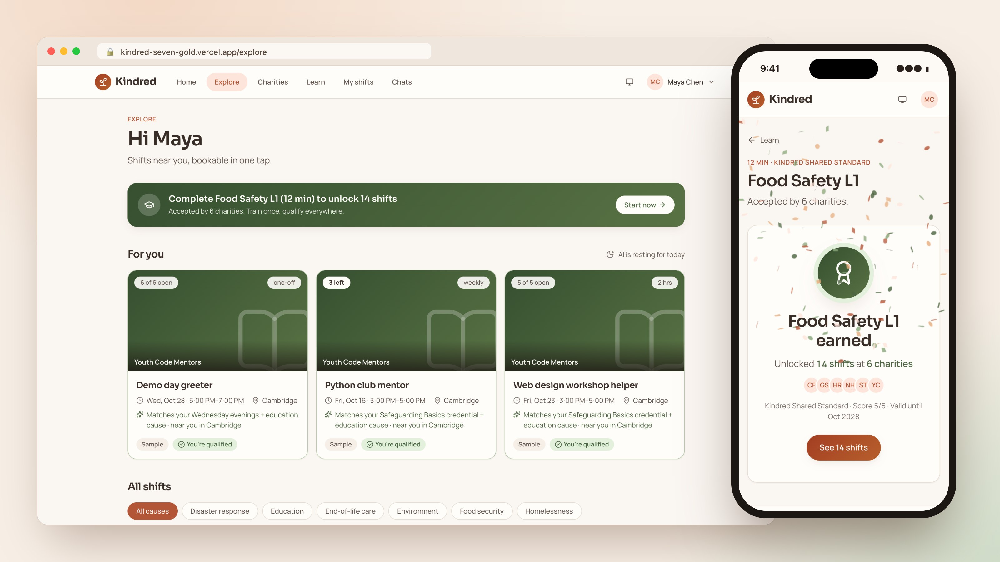
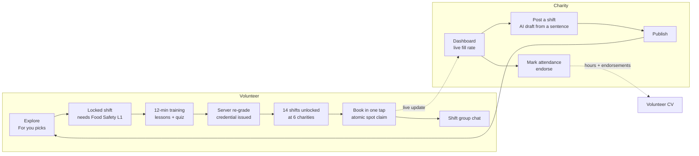
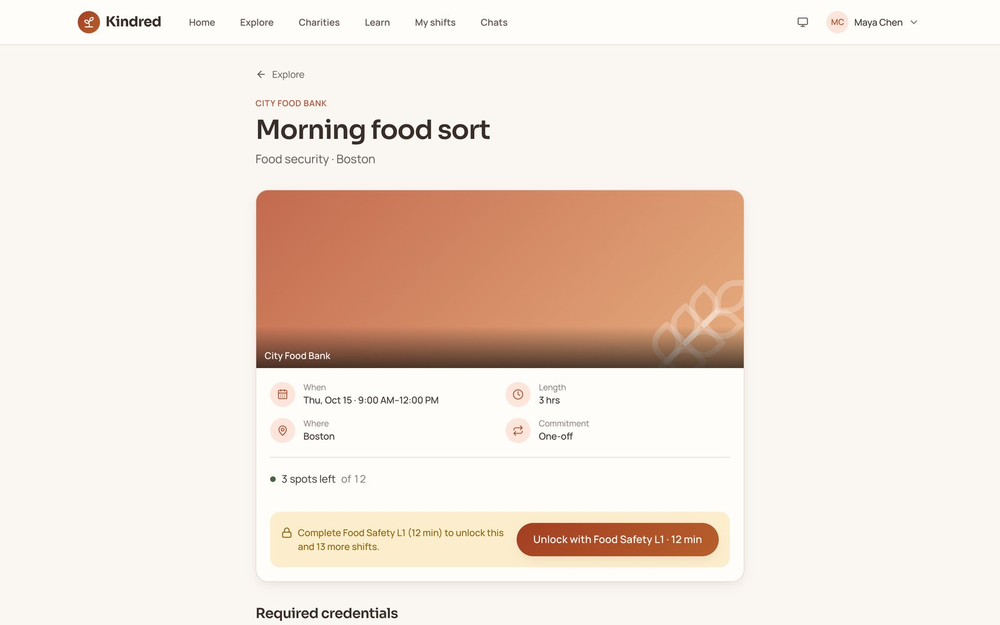
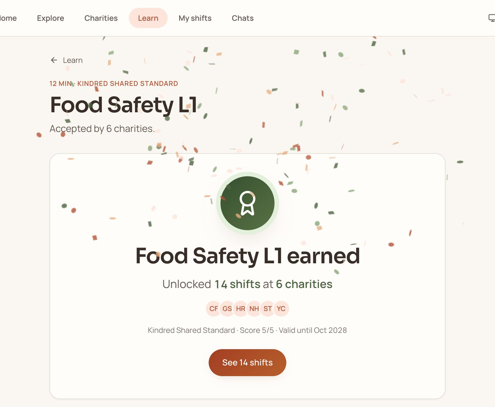
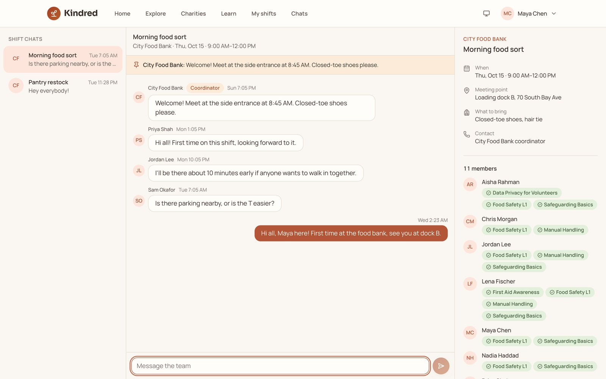
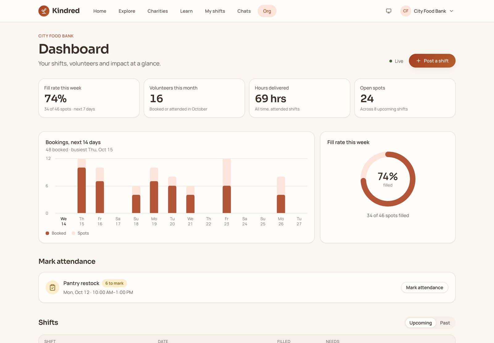
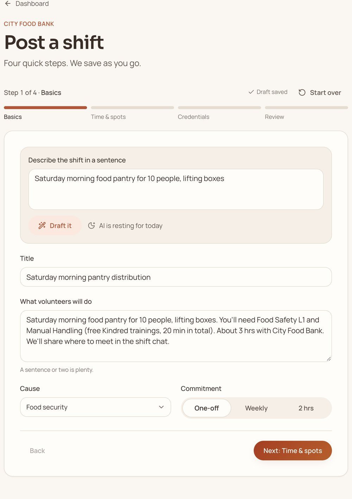
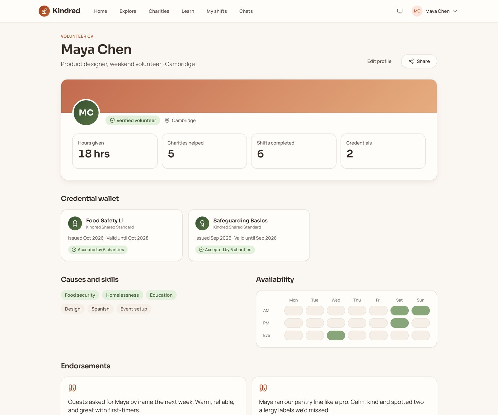

# Kindred: volunteer once, qualify everywhere

**Live demo** · Role: product, design and build (solo, AI-assisted) · Oct 2026 · Next.js 15 · React 19 · TypeScript ·
Postgres (Neon) with row-level security · Vercel · Claude Haiku 5.5 · Claude Code

*Maya's marketplace, and the moment one 12-minute training unlocks 14 shifts at 6 charities. Live site, demo data.*

## TL;DR
- **A two-sided volunteering marketplace built around one insight:** people don't drop out of volunteering for lack
  of motivation, they drop out because joining each charity feels like applying for a job.
- **Shared training credentials replace per-charity onboarding.** One 12-minute course, graded on the server, unlocks
  14 shifts at 6 charities; booking is one tap and lands you in the shift's group chat.
- **Built in two days, live from day one:** 37 commits, 9 merged pull requests, 208 automated tests, row-level
  security on every table, and AI that can't break the demo or the budget.

[Live demo](https://kindred-seven-gold.vercel.app) (click "Try as Maya", no sign-up)

## The problem
Joining an established charity looks a lot like a hiring process: an application, checks, an induction and the
charity's own training, then a wait. A volunteer who wants to help at a food bank, a shelter kitchen and a hospice
goes through that three times, and much of it is the same content. Food safety basics are food safety basics.

The result is lost supply on both sides. Willing people give up before their first shift, and charities can't staff
their peaks even though qualified volunteers exist nearby. The duplicated training is the waste worth attacking.

## Approach and key decisions
- **Make the credential the product.** Instead of another listings site, the unit of value is a portable, verified
  training credential that every participating charity accepts. The marketplace, booking and chat exist to make that
  credential pay off immediately: "Unlocked 14 shifts at 6 charities."
- **Design the demo before the features.** I wrote the 60-second story first (Maya earns Food Safety L1, books in one
  tap, lands in the group chat, the charity sees it live) and seeded the data to make it true: exactly 14 shifts at 6
  charities need that credential, and a test fails if the seed ever drifts.
- **Prototype in Lovable, build in code.** The first prototype set the look and the flows. The product itself was
  rebuilt in Claude Code so I controlled the database, the security model and the AI layer, then the prototype's
  design language was carried back over as a token-based design system.
- **Charities are customers too.** A dashboard with fill rate, hours delivered and a live bookings feed, plus a
  four-step "post a shift" wizard that AI can fill from one sentence, gives the supply side a reason to join.
- **One step at a time, end to end.** Thirteen spec steps, each merged only after lint, types, tests, a production
  build and a browser run of the demo path, then logged in a status file a teammate could pick up from.

## How it works

- **Marketplace:** photo-led shift cards with "You're qualified" or "Needs: Food Safety L1", filters held in the URL,
  live spots, and a banner that names the training that unlocks the most shifts for you.
- **For you:** three matched shifts with a one-line reason each ("Matches your Saturday mornings + Food Safety L1
  credential"), from Claude or a deterministic scorer of the same shape.
- **Trainings:** five short modules accepted by all six charities, resumable mid-course, ending in a credential with a
  printable certificate and a verification ID.
- **Volunteer CV:** hours given, charities helped, a credential wallet and endorsements from charities whose shifts
  you actually attended.
- **Charity side:** KPIs, a 14-day bookings chart, applicants with their credentials, attendance marking and
  endorsements. **Admin:** kill switch per feature, AI spend against the daily cap, roles and an audit log.

| | |
|---|---|
|  |  |
| *The locked shift names the 12-minute fix and what else it unlocks.* | *The quiz is re-graded on the server before anything unlocks.* |
|  |  |
| *Booking drops Maya into the shift chat; teammates' credentials sit beside it.* | *Maya's booking reaches City Food Bank's dashboard live; the fill rate ticks up.* |

## Four hard problems
**1. A credential has to mean something.** If the client can claim a pass, the whole idea is worthless. The answer key
lives in a database column the app's role can never read; the server re-grades every submission (4 of 5 to pass),
issues the credential idempotently and writes an audit row. Quiz attempts are rate limited so answers can't be
guessed by brute force, and "Demo mode" fills the correct answers on the server, only for demo accounts.

**2. The last spot, tapped by two people at once.** Booking claims a row first (so double taps collapse into one),
then decrements `spots_left` with a conditional update that only succeeds while spots remain, and rolls back if it
doesn't. A test races two users for the last spot (exactly one wins) and fires five concurrent taps from one user.
Cancelling gives the spot back, and the chat seat with it.

**3. AI that can't break the demo or the bill.** Both AI features (matching and shift drafting) run through one
function. Before each call it reserves the worst-case cost against a $1/day budget with a single conditional update;
volunteers can use 80% of the cap, so the last 20% is always there for a live demo. Afterwards the reservation is
reconciled to the real cost. User text is redacted and kept out of the instructions, output is re-validated
(unknown shift IDs dropped, gaps filled from the deterministic ranking), and every failure path (no key, switch off,
budget spent, timeout, invalid output) returns a scripted answer of the same shape. With no API key at all, every
screen still works.

**4. A shared demo world that strangers can't wreck.** Anyone can click "Try as Maya", so the demo has to survive the
public. "Reset demo" undoes every demo-account change in one transaction (credentials, bookings, messages, posted
shifts, attendance marks) and re-runs the seed, in about 0.2 seconds; a test checks the result equals a freshly
built database. Demo accounts get their own sign-in rate limit, quiz limits per account and IP (so someone elsewhere
can't lock the room out), and are protected from role changes in the admin console.

## Quality and security
- **Row-level security on every table**, each assigned one access model (private, shared with members, public read,
  admin, system). Every user-scoped query runs as a restricted role with the user's ID set, so Postgres enforces
  access, not application code. Forbidden and missing look identical.
- **A security test that fails on omission:** it enumerates every table and function, and fails if a new table has no
  declared access model, a privileged function has no caller check, or a server action skips the wrapper that
  validates input, checks the session, applies the kill switch and rate limits.
- Own authentication (bcrypt, breached-password check, hashed sessions rotated at sign-in), a per-request nonce
  Content-Security-Policy, PII redaction before chat storage and AI calls, safe redirects and an audit log.
- **Speed where the demo needs it:** fixed a framework quirk that held pages up to 4 seconds after an action (now
  40 to 85 ms), and cut the wizard's JavaScript from 34.6 kB to 7.1 kB.

## Results
- **Live in two days:** 37 commits and 9 merged pull requests, on Vercel and Neon with preview deployments on a
  separate database branch.
- **208 automated tests** against a fresh database on every run, plus CI running lint, types, tests and a production
  build on every pull request.
- **The judges' path is fast:** landing 0.13 s, Try as Maya to matched shifts 0.34 s, earn the credential 23 ms,
  book to chat 54 ms, reset the demo 0.18 s (production build, measured in the browser).

## What's next
- A background-check partner, so "verified" covers identity and safeguarding, issued once and reused like training.
- Credentials as signed Open Badges, so other platforms can verify them without trusting Kindred's database.
- Charity single sign-on, notifications, password reset and distance search.

---
Charities and people in the demo are fictional. The code is private; a walkthrough or read access is available on
request.
