# charlesbingaman.com: a photography portfolio, client platform and photo map in one

**[Live](https://www.charlesbingaman.com)** · Code: private, read access on request · Role: photographer, product, design and engineering (solo, AI-assisted) ·
Jul–Oct 2026 · TypeScript · Next.js · Postgres + pgvector · Cloudflare R2 · Vercel

*The Mt. Washington project on desktop and phone.*

## TL;DR
- **A complete back office for a working photographer, with nothing they don't need:** culling, client
  delivery, proofing, inquiries and security in one admin.
- **Replaces two paid products** (SmugMug-style portfolio and Pixieset-style client delivery) on near-free infrastructure.
- **Automatic subject-aware cropping at no API cost:** 69% of crops land within a tenth of a hand-placed point, vs 18%
  for centre-cropping, at ~90 ms per photo.
- **Location-safe by design:** public precision per gallery, and GPS scrubbed in place from client downloads.

## The problem
Off-the-shelf portfolio tools look templated, charge monthly, and split portfolio and client delivery into separate
products. They also leak: an original sent to a client carries GPS precise enough to find the house where a family
session was shot.

## Approach and key decisions
- **Designed from the photographer's chair:** every admin screen maps to a real job in the week (cull, deliver,
  follow up, protect), and anything that doesn't earn its place is left out.
- **Build, not buy:** one site where the photographs are the interface, with portfolio and client delivery together.
- **Near-free running cost as a design rule:** open-licence models run in WebAssembly inside the serverless function
  instead of a paid vision API; the map uses a self-hosted tile archive instead of a map provider.
- **One gateway for location data,** with a build-time guard that fails the build if anything else reads coordinates.
- **Snap, don't jitter:** public photos snap to reference points many photos share, because random jitter averages back
  to the true spot.

## What it does
- **Public portfolio:** strictly monochrome, image-first galleries with focal-point-aware cropping, modern image formats,
  and no trackers or cookie banner.
- **Client projects:** public, private, or shared by password link or named accounts, with proofing, favourites, review,
  expiry, tiered downloads and emailed zip delivery.
- **Admin vault for thousands of photos:** culling with quality scoring and burst detection, semantic search over
  multimodal embeddings, bulk edits with undo.
- **Photo map:** every geotagged photo on a 3D globe, with trip paths, GPS-track import, location estimates for photos
  without GPS, and shoot planning by sun angle.

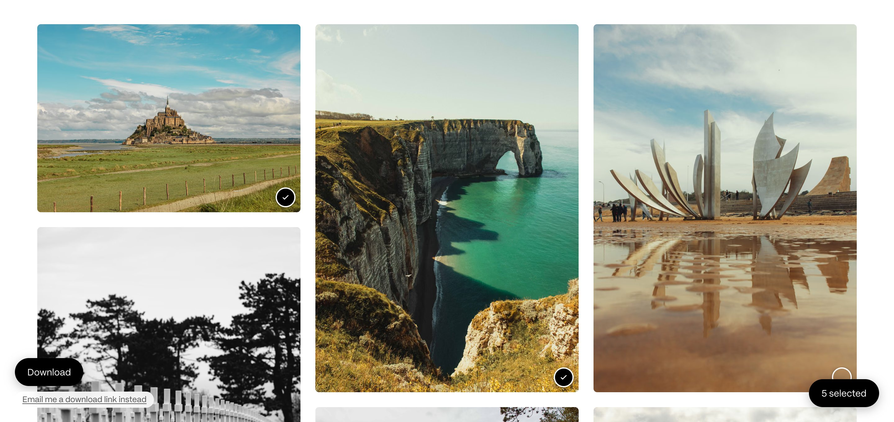
*Proofing: the client marks picks, then downloads the set or asks for an emailed link.*

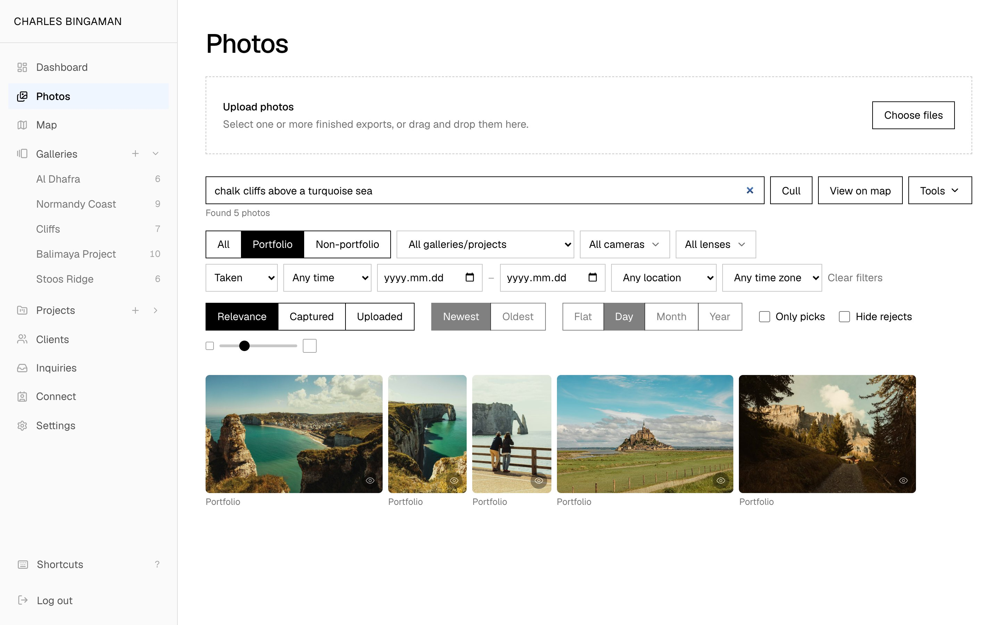
*Semantic search in the admin vault: "chalk cliffs above a turquoise sea" matches by meaning, not by keyword.*

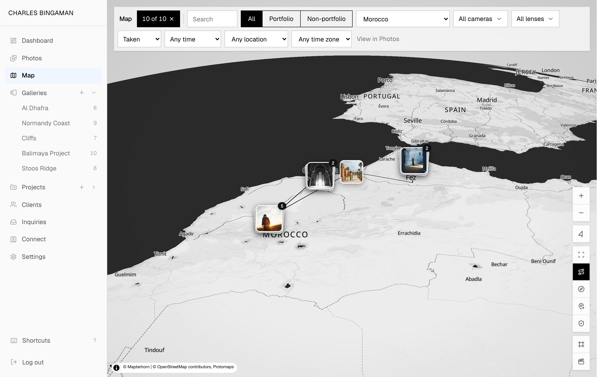
*The photo map: a Morocco trip as a path across the 3D globe.*

## Inside the admin
A photographer's whole week, from culling to delivery to follow-up, in one calm interface. Real app, demo data:
fictional clients, my own landscapes.

<table>
<tr>
<td width="50%">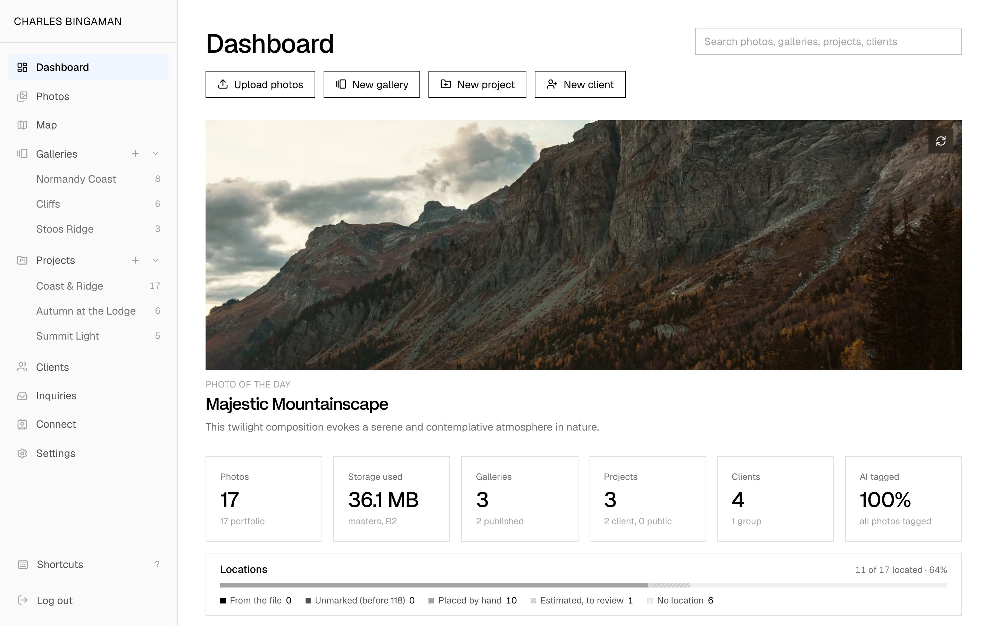 <b>Start the day:</b> storage, galleries, clients and location coverage at a glance.</td>
<td width="50%">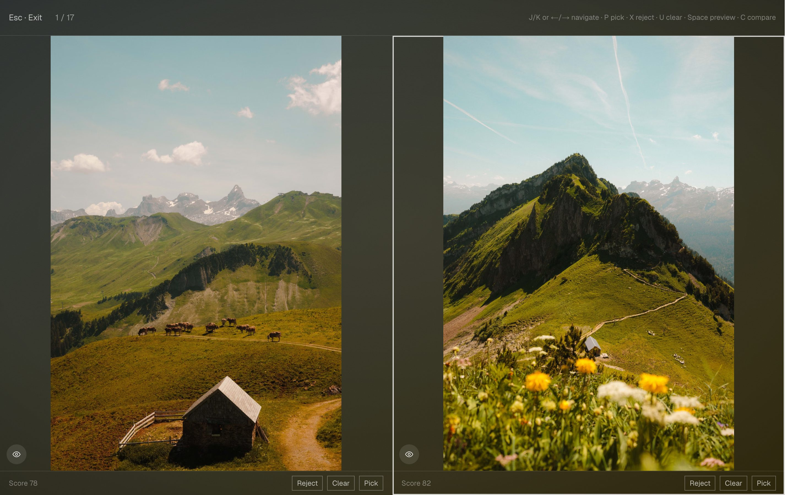 <b>Cull a shoot:</b> near-duplicates side by side with a quality score; pick or reject by key.</td>
</tr>
<tr>
<td width="50%">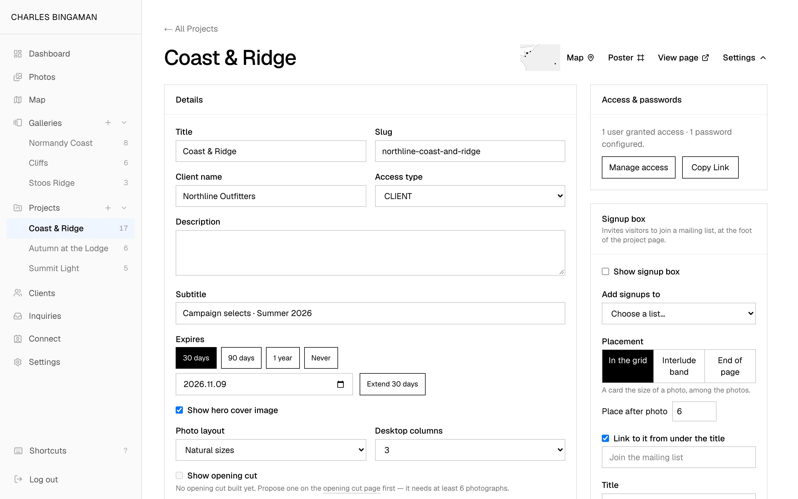 <b>Deliver to a client:</b> access type, passwords, named accounts and a one-click expiry extension.</td>
<td width="50%">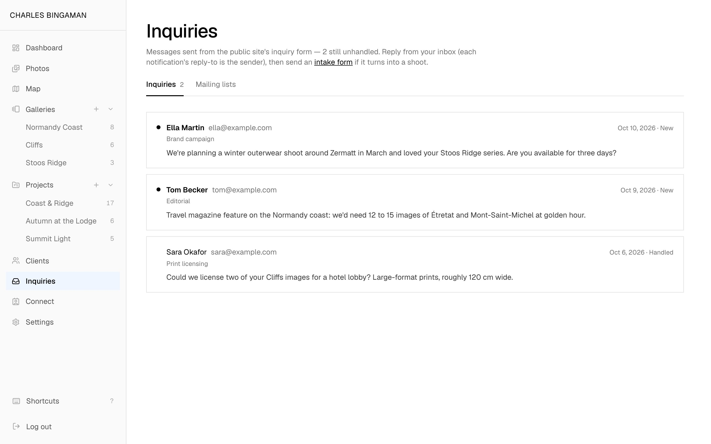 <b>Answer new work:</b> site inquiries stay flagged until handled, with an intake form one step away.</td>
</tr>
<tr>
<td width="50%">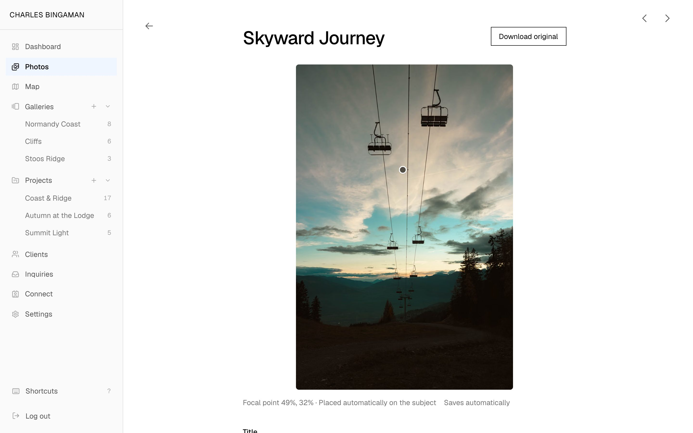 <b>Frame every crop:</b> the focal point lands on the subject at upload and moves by hand.</td>
<td width="50%">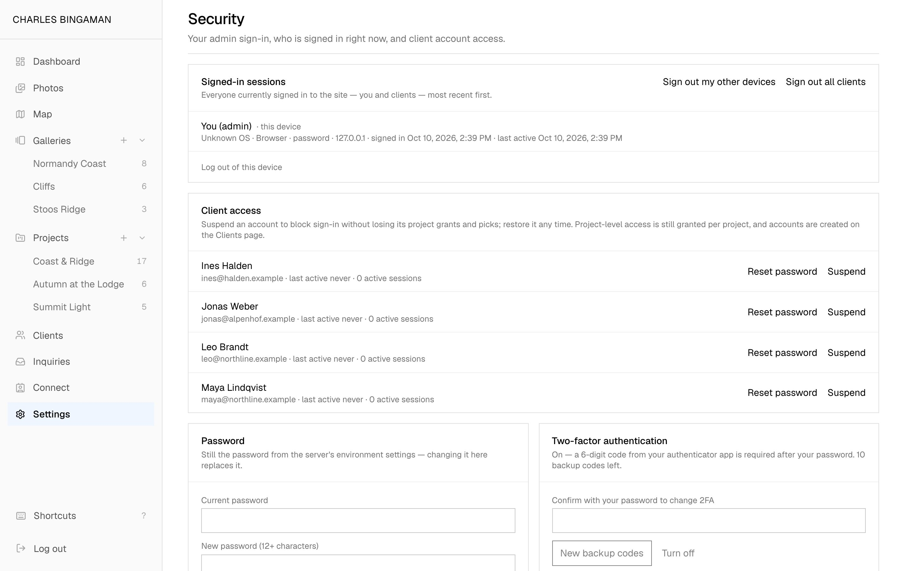 <b>Stay in control:</b> who is signed in, client accounts, two-factor and passkeys on one page.</td>
</tr>
</table>

## Three hard problems
**1. Location that is useful privately and safe publicly.** Public precision is per gallery (country, region, city or
exact), with privacy zones and per-photo opt-outs. Full-resolution client downloads have GPS and street-level place names
scrubbed **in place**, with same-length byte patches inside the metadata, so image, camera data and file size are untouched.

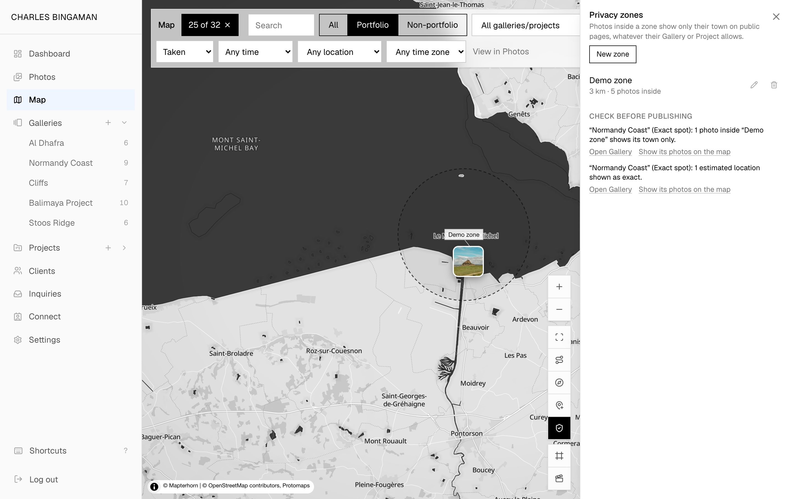
*Privacy zones: photos inside a zone show only their town publicly, and a pre-publish check flags galleries that would show more (demo zone on a public landmark).*

**2. Putting photos in order when cameras lie about time.** Cameras record wall-clock time with no time zone, bodies
drift, and phones disagree. The archive stores each photo's zone and derives a true instant; admin tools shift a
selection, set the first photo's real time, or align a camera to a phone shot of the same moment, all previewed and
undoable. On a 20,000-photo stress test, simplified trip paths cut ~20,000 segments to ~3,000 and redraw time from
~0.9 s to ~0.5 s.

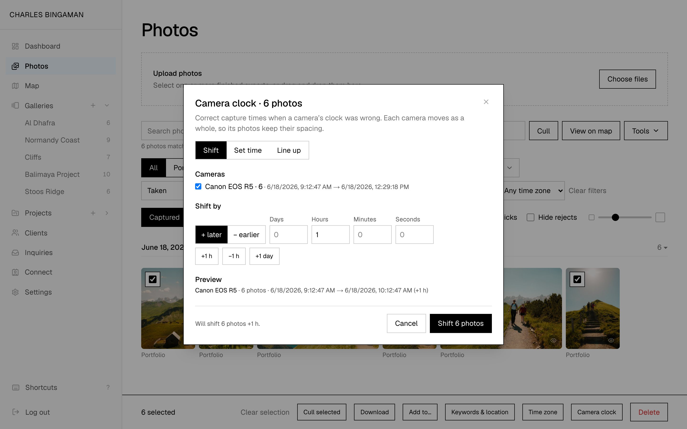
*Camera clock correction: shift a selection and preview every camera's new times before applying.*

**3. Cropping to the subject automatically, for free.** Hand-placing 2,000 focal points doesn't scale. Uploads run two
small open-licence models (face, then person/animal/vehicle, else centre). Scored against 835 hand-placed points, 69%
land within a tenth of the crop, vs 18% for centre-cropping and 14% for the built-in "attention" crop. A manual point
always wins.

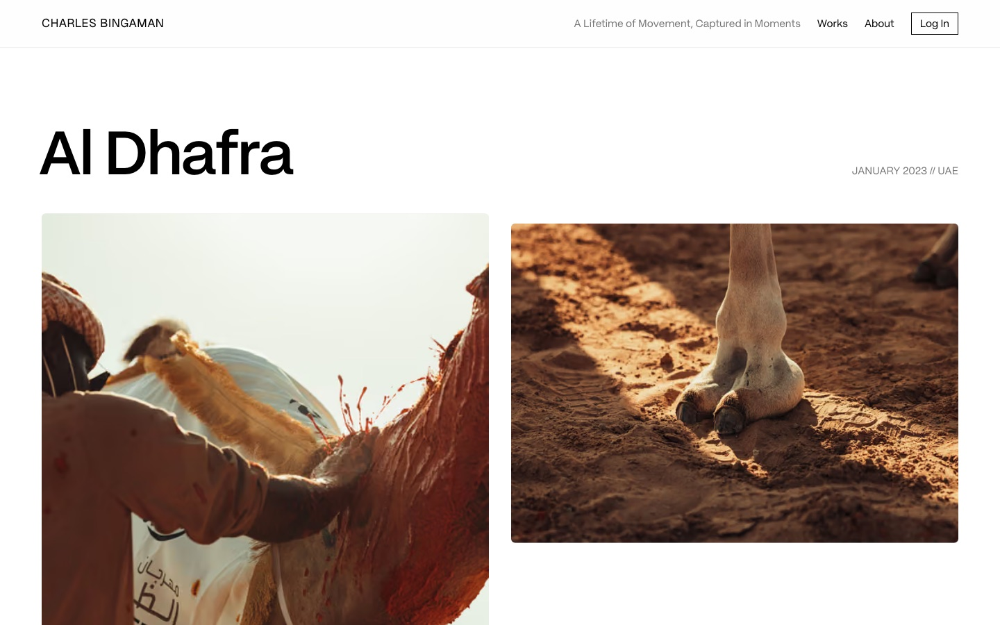
*A public gallery: every crop follows the photo's focal point.*

## Architecture
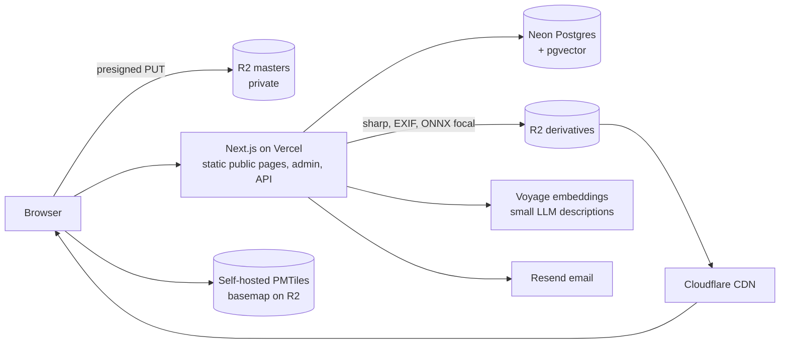
Public pages are static and revalidated on admin edits; uploads go straight to private storage, then a server step builds
immutable CDN-served derivatives, reads EXIF and places the focal point.

## Results
- 725 commits on `main`, 462 merged pull requests, about 126k lines of TypeScript over 34 active days.
- 154 written feature specs; passkeys and two-factor sign-in; no third-party trackers.

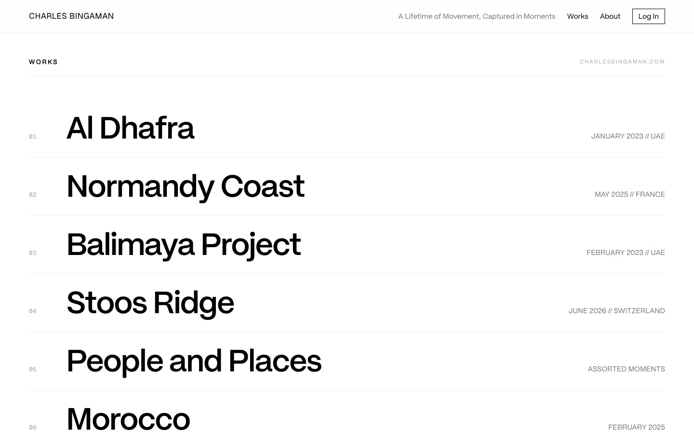

---
Code: a private snapshot of the full codebase; read access on request.
