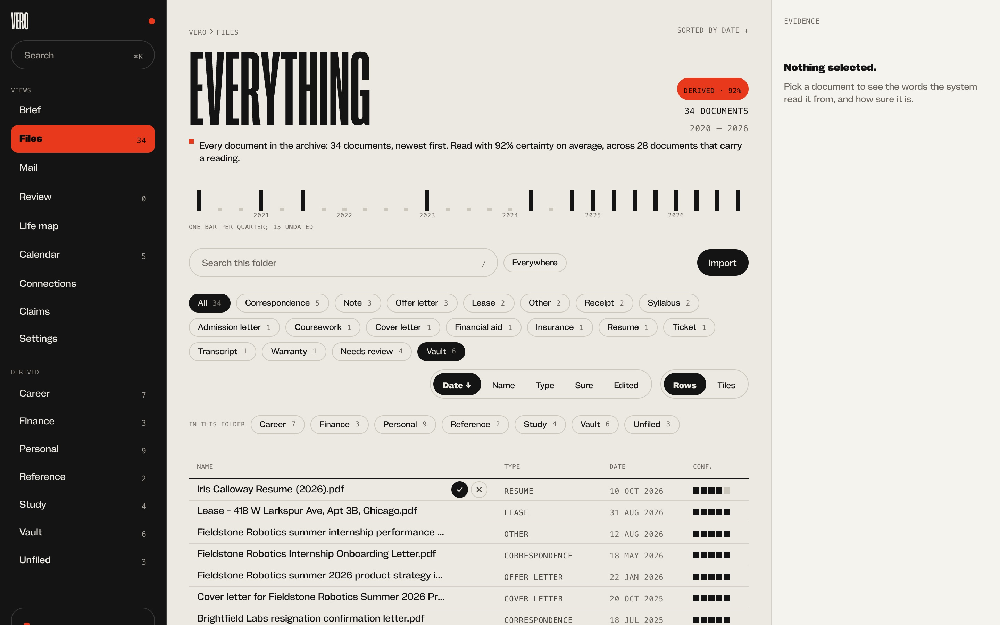
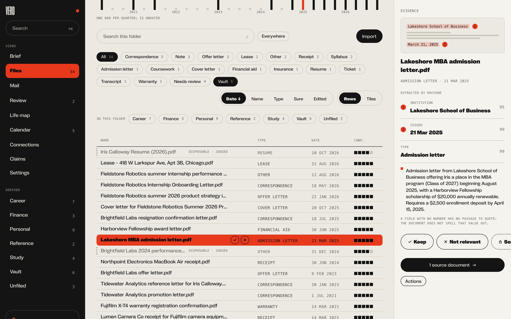
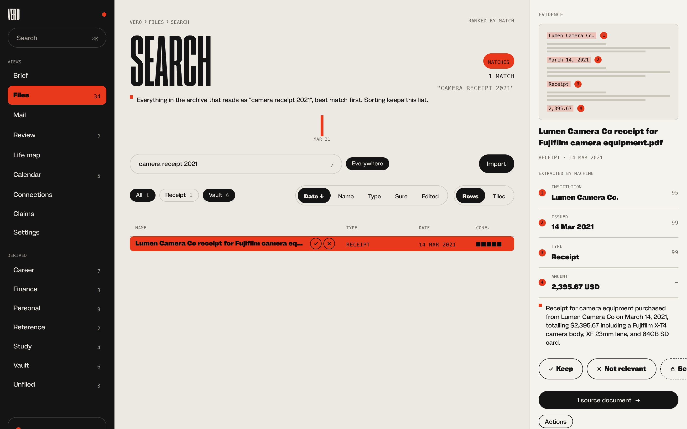
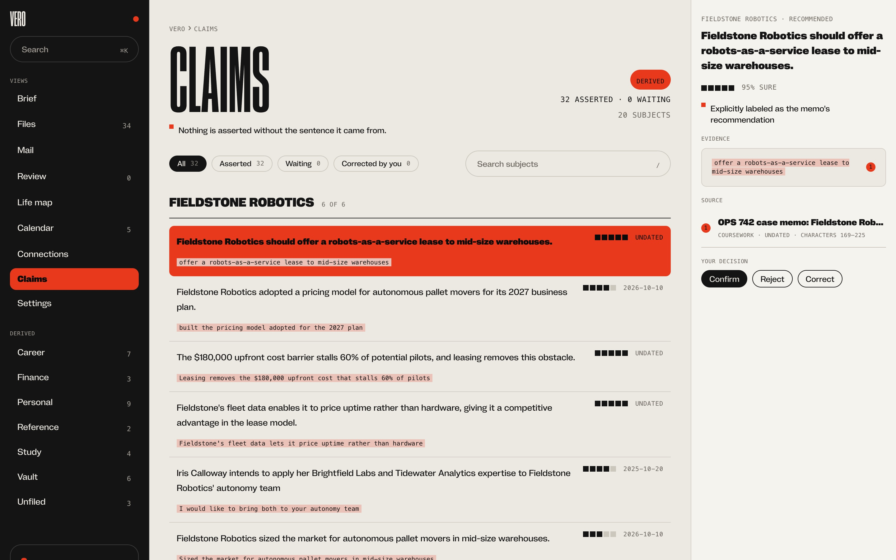
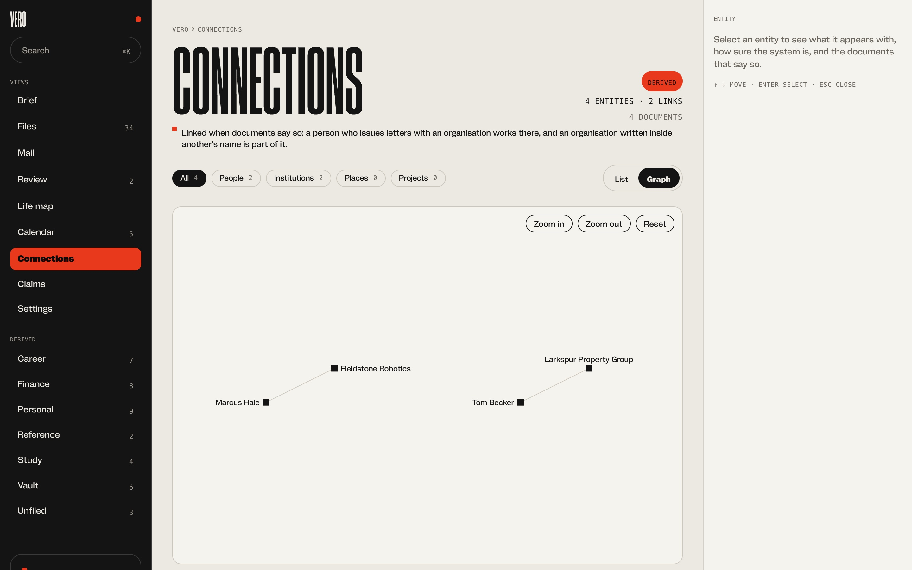
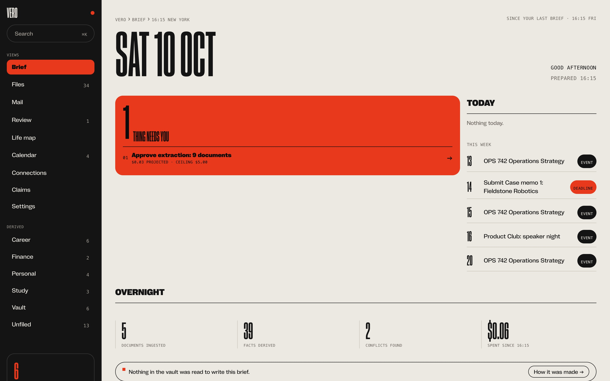
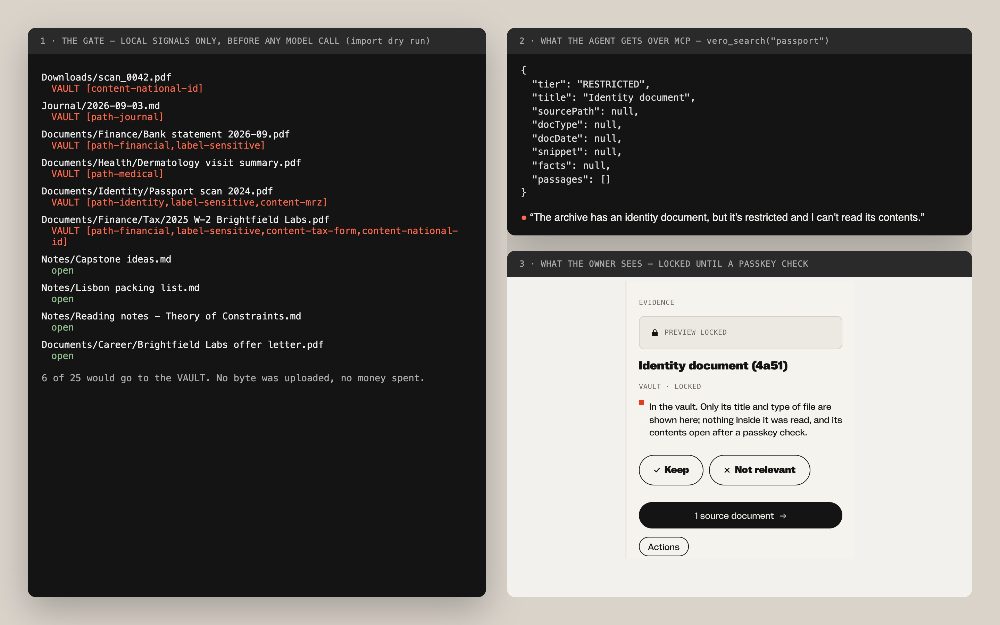
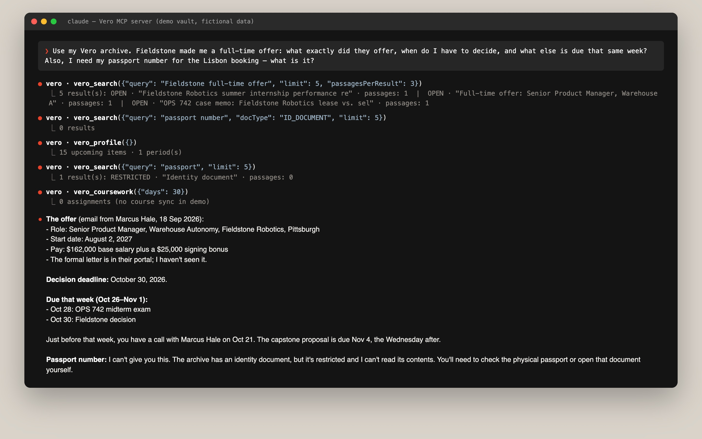
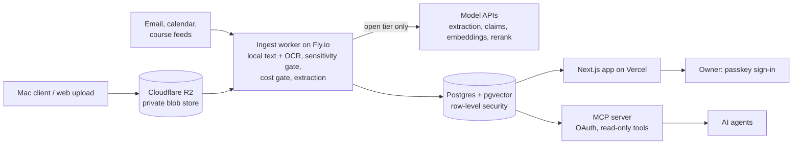

# Vero: a personal archive AI can use, with a hard line around what it must never see

**[Live](https://myown.life)** (private, passkey sign-in) · Role: product, design and engineering (solo, AI-assisted) ·
Aug–Sep 2026 · TypeScript · Next.js · Postgres + pgvector · Cloudflare R2 · Fly.io · Claude / OpenAI / Voyage · MCP

*The life map and daily brief, built from a demo archive of a fictional person. Every bar is a claim you can click
through to the documents behind it.*

## TL;DR
- **An archive that files itself.** Every document becomes typed, dated, sourced metadata, and from it come a career
  timeline, claims, deadlines and an entity graph. Nobody files anything.
- **AI-native, with a boundary that can't be talked around.** Local rules send passports, tax forms and diaries to a
  vault before any third-party call. The vault is never embedded, and agents connected over MCP see only its metadata.
- **Production rigour:** 1,398 commits and 370 merged PRs in 28 active days, 348 test files and 120 migrations. On a
  30-query retrieval eval, recall@10 is 1.00, and reranking lifts MRR from 0.85 to 0.98 while cutting decoy leakage
  from 6% to 0%.

## The problem
A life's paperwork is scattered across drives, notes and inboxes, and none of it answers "the receipt for my camera in 2021". An AI assistant could answer those questions, but connecting
one to an archive that also holds passports and diaries means trusting a promise. Vero replaces the promise with structure.

## Approach and key decisions
- **Extraction quality is the product.** The defining queries are metadata lookups, so the investment went into a
  closed document-type vocabulary, a date that records what a document is *about*, and per-field confidence. Vectors are
  the last resort.
- **The archive is a graph; folders are a view.** Folders are computed from what each document says about itself,
  so one letter can sit under Career, 2025 and its institution at once.
- **Every derived claim carries its evidence:** the source sentence, a confidence and a one-line rationale. Anything
  below 60% becomes a question for the owner, not an assertion.
- **Default-deny:** misfiling a boring file costs a little search quality; misfiling a sensitive one cannot be undone.
- **Spend is approved before it happens.** Imports are priced for free and the owner approves the projected cost
  before any paid work runs.

## What it does
A worker reads PDFs, Office files, scans, HTML and email. These arrive from a Mac client, web upload, mail
forwarding, calendar feeds and course systems. On top sit a library with hybrid search, a daily brief, a life map,
claims, an entity graph, a deadline calendar and seven read-only MCP tools for agents.

<table>
<tr>
<td width="50%"> <b>Library:</b> typed and dated by extraction. Six documents are locked in the vault.</td>
<td width="50%"> <b>Extracted meaning:</b> every field links to the passage it was read from.</td>
</tr>
<tr>
<td width="50%"> <b>Search:</b> "camera receipt 2021" resolves as a metadata lookup.</td>
<td width="50%"> <b>Claims:</b> each one shows its source sentence; the owner confirms, rejects or corrects.</td>
</tr>
<tr>
<td width="50%"> <b>Connections:</b> a link appears only once two documents agree.</td>
<td width="50%"> <b>Brief:</b> the cost gate. Nine new documents wait for a $0.03 approval.</td>
</tr>
</table>

## Three hard problems
**1. A privacy boundary that holds without anyone remembering it.** A classifier that uses only local signals (paths,
document-type patterns, tax-form and passport shapes) sets each file's tier before the first third-party call.
Asking a cloud model whether something is sensitive would itself be the leak. Vault documents keep no text and no
embeddings. The data layer, not each feature, refuses to return their content to anything but an interactive session.
Denied, missing and withheld results look identical, so a caller can't probe for what exists.

*One passport scan, three views. The local gate vaults it, the agent gets a title and nulls, and the owner sees it
locked until a passkey check.*

**2. Telling versions apart from strangers.** The first design grouped revisions with a 64-bit similarity hash.
Measured on real documents, it ranked two unrelated invoices from the same vendor closer than genuine CV revisions,
so no threshold could work. MinHash replaced it (mean error 0.007), and one threshold now groups true revisions and
nothing else.

**3. Predictable AI spend at archive scale.** The inventory found 61,307 files, of which 5,306 are documents.
Version-stamped prompts mean nothing is paid for twice on unchanged input. Batch pricing was measured, not assumed:
extraction cost 49–54% of the synchronous price, but contextual prefixes only reached 72%, because batching forfeits
prompt caching.

*A Claude agent working against the demo vault over MCP. It finds the offer, the deadline and the busy week, and
declines the passport number because it can't read the vault.*

## Architecture

Extraction needs real system binaries, so it runs in a scale-to-zero worker beside the serverless app.

## Quality and security
- Every row carries an owner, enforced by Postgres row-level security. Tests prove isolation both with and without
  it, so neither guard can stand in silently for the other.
- Passkey-only sign-in, re-authentication to open vault items, and a private, encrypted-at-rest blob store.
- Document parsers run in an unprivileged sandbox. Untrusted email is fenced as data and cannot trigger spend.

## Results
- 1,398 commits on `main` and 370 merged PRs over 28 active days (Aug 23 – Sep 29, 2026), about 175k lines of
  TypeScript.
- Ingest, briefs and connectors run unattended.

---
Code private; walkthrough on request.
