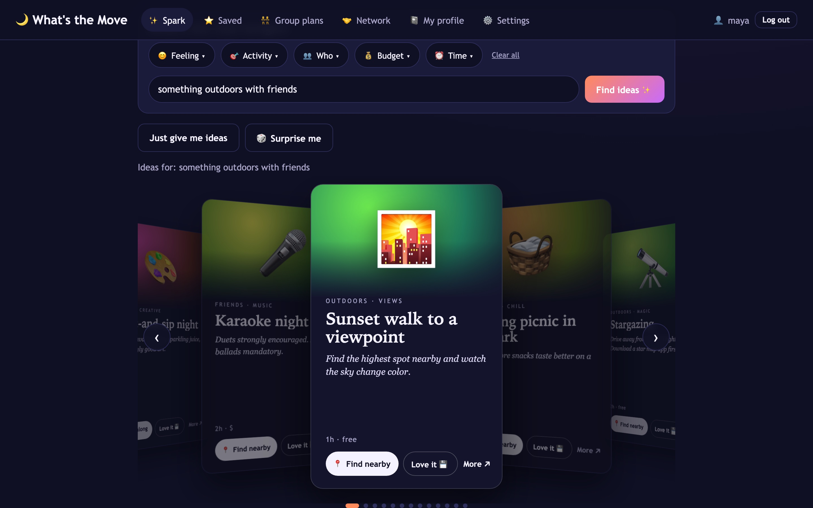
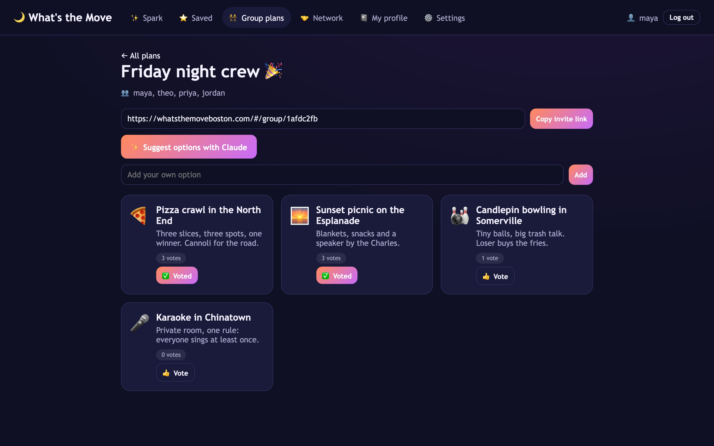
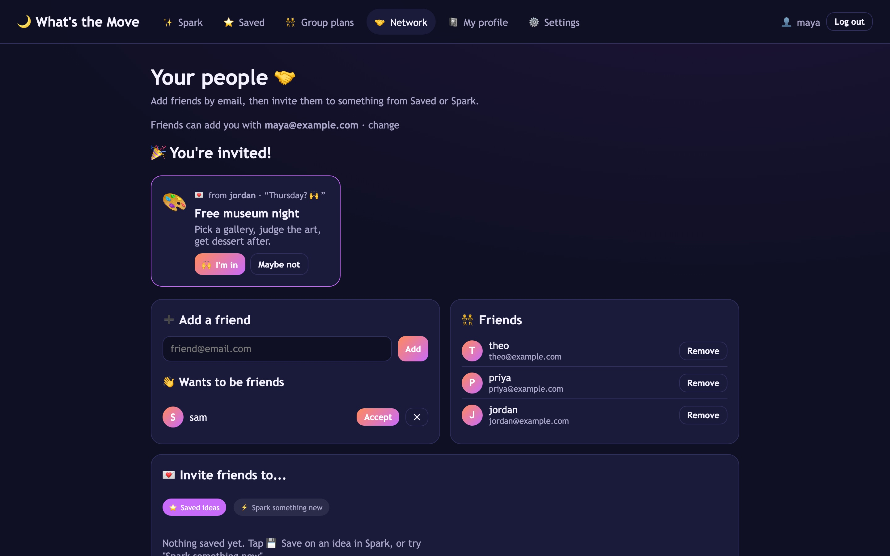
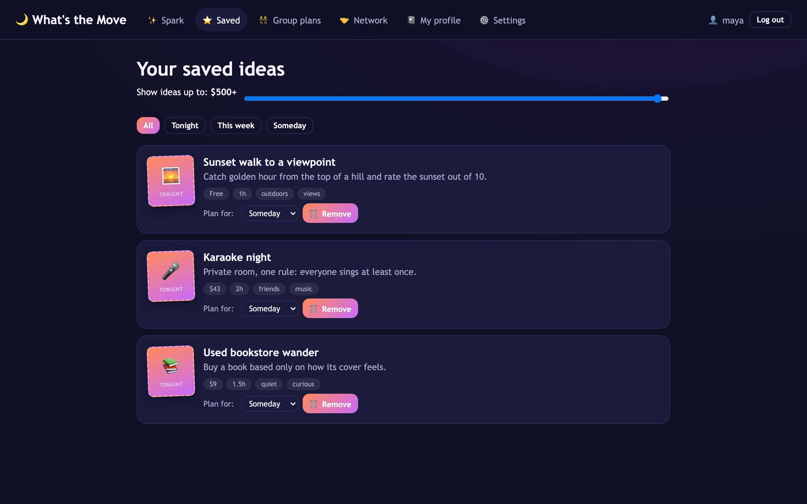
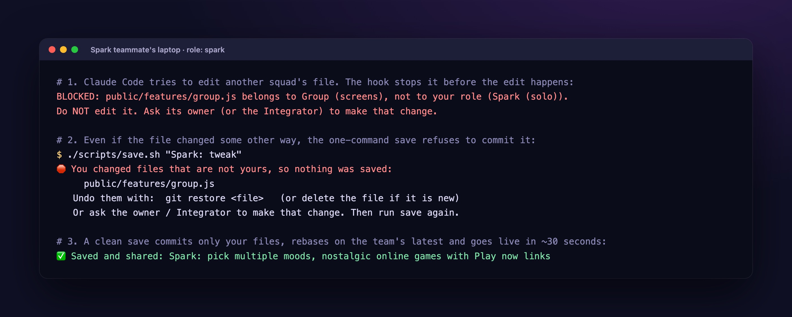
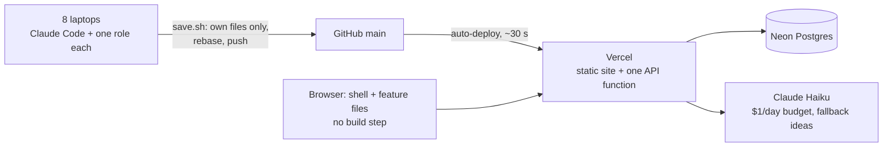

# What's the Move Boston: eight people, mostly beginners, one live app in 90 minutes

**[Live](https://whatsthemoveboston.com)** · Code: private, read access on request · Role: Integrator on a team of 8
(system design, contracts, guardrails, security, deploy) · Sep 23, 2026 · Plain JavaScript · Node · Postgres (Neon) ·
Vercel · Claude API · Claude Code

*Spark on desktop and the public landing page on a phone (local demo copy, fictional accounts).*

## TL;DR
- **Live before the team arrived:** the site was on its own domain 26 minutes before the first teammate's commit, so
  every save went straight to one shared URL, live in about 30 seconds.
- **Beginners pushed to `main` without breaking each other:** one owner per file, enforced by a Claude Code hook and a
  one-command save. 19 commits from 4 roles landed in the 90-minute window.
- **Hardened into a public product afterwards:** landing page, hashed sessions and lockout, a strict content security
  policy, and a $1-a-day AI budget that admitted exactly 7 of 40 parallel calls against a 7-call cap.

## The problem
"What should we do tonight?" is a question every group chat answers badly. We had 90 minutes and eight people, most of
whom had never shipped code. The risk wasn't the idea; it was eight people editing one codebase at once and ending with
a demo that didn't run.

## Approach and key decisions
- **Ship the plumbing first.** Before the event I built the shell, login, feature contract, shared database and
  deploy, and pointed the domain at it. Teammates only ever added to a working, live product.
- **One owner per file.** Each feature is one file that registers itself with the shell; `ownership.json` maps every
  file to one role, so nobody edits the same file and rebases never collide.
- **Claude Code as every teammate's pair.** The repo tells Claude who it's helping: find their role, edit only their
  files, speak plain English, run the site for them. "Save" ran one script; nobody needed git.
- **Everyone on `main`, contracts instead of meetings.** Review is too slow for 90 minutes, so guardrails ran on each
  laptop, and the data shapes and API were written down once for everyone to build against.

## What it does
**Spark** turns a mood, budget and time into a deck of specific ideas (Claude when it's on, a curated catalog when not).
**Group plans** share one link where everyone adds options and votes. **Network** adds friends and turns a saved idea
into a plan. **Saved** and a six-question **Boston notebook** profile shape every suggestion.

<table>
<tr><td> Spark: one request becomes a swipeable deck of ideas.</td>
<td> A group plan: options, live votes, one invite link.</td></tr>
<tr><td> Network: invites, friend requests and the friends list.</td>
<td> Saved ideas as flyers, filterable by price and timing.</td></tr>
</table>

## Three hard problems
**1. Eight beginners pushing to one live site at once.** A Claude Code hook stops an edit to someone else's file before
it happens, and the save script refuses to commit one anyway. Both explain the fix in plain English. A clean save
commits only your files, rebases and pushes:

**2. The same code on a laptop and on serverless hosting.** Features work with plain objects and call `save()`. Locally
that's a JSON file with zero setup; live, the server loads from Postgres per request and writes back only what changed.
Each feature loads separately, so one broken file is skipped instead of taking the site down mid-event.

**3. A public AI demo that can't run up a bill.** Every Claude call reserves its worst-case cost in a single database
update before it's made, then settles to the real cost. Past $1 a day, users get the built-in ideas with a friendly note.

## Architecture

## Quality and security
scrypt passwords, sessions stored only as hashes, lockout after five failures, emailed reset links, same-origin
JSON-only writes, a strict content security policy, and per-user plus site-wide AI limits. The event version had no
CI; adding checks with automatic revert was the first thing the hackathon template improved.

## Results
- **Live all evening:** on its custom domain at 19:02, first teammate commit at 19:28, 35 commits that day.
- **Six features, four roles, about 3,600 lines** of plain JavaScript, CSS and HTML with 27 API routes.
- **The seed of my [hackathon template](hackathon-template.md),** whose first run was [FirstCall](firstcall.md).

## Credits
A team of eight, credited by role: Integrator (me), Spark, Saved, Profile, Group screens, Group server, Network, and
Design & demo. Spark's catalog, the Boston notebook and the Saved list are teammates' work; the system, accounts,
landing page and AI budget are mine.

---
Screens come from a local copy of the app with fictional demo accounts.
